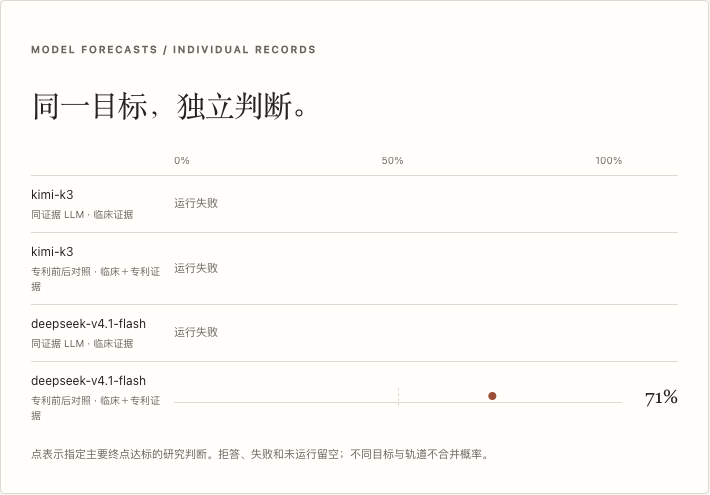

# TRIUMPH-5：完整专利实验卡的第二版真实配对

本轮把已核查的 Table3 与 casein Table4 完整卡接入现有预测执行器，完成两模型、两证据条件的四次首轮真实请求。最终为 **1 条有效结构化预测、3 条操作失败**。这是同一个 retatrutide 项目的输入版本比较；独立药物项目仍为1，不能据此判断专利增益或模型预测优劣。

[原v1研究](PATENT_PAIR_PILOT.md)的输入、三条有效输出和一条失败保持原样。本轮没有补跑或替换v1失败槽。新 cohort 为 `of-retatrutide-assay-pair-20261027-v2`，[机器可读运行摘要](records/triumph5-assay-pair-20261027/run-summary.json)记录实际状态、时间、版本及输入输出哈希。

## 预测的具体问题与输入

TRIUMPH-5 / [NCT06662383](https://clinicaltrials.gov/study/NCT06662383)比较 retatrutide 与 tirzepatide，登记的主要终点为 Baseline–Week80 体重相对基线百分比变化。登记确认随机、双盲和预计800例；800不是实际分析人数。完整 protocol/SAP、剂量、estimand、分析集、alpha、多重性及正式优效性假设均未取得。

预测事件仍是条件式研究定义：未来官方报告明确确认本试验预设Week80主要优效分析达标。缺少相应方案资格证明时继续待定或保留Mixed/Inconclusive，不用数值减重、其他TRIUMPH结果、延期或无公告强行判定成功/失败。官方公布日期未知；2026-11/12的预计完成时间不作为公布日期。

- 共同信息截止为 **2026-10-26 23:15:30 UTC**，提交截止为次日05:15:30 UTC。
- 23:16:03–23:16:05 UTC实际执行新的有界中英文官方来源检索，没有取得需停止准备的精确目标决定性结果。这不证明全球未披露，也不认证前瞻资格。
- 两臂共享完整临床包：TRIUMPH-5登记、不同试验的TRIUMPH-1背景，以及不同比较/Week72的SURMOUNT-5结果。两模型使用相同包、事件、cutoff、单次工作流和预算规则。
- 专利臂只追加 WO2019125938A1 Example12 / SEQ17 的 Table3 与0.1%casein Table4工程细胞cAMP卡。EC50/SEM/n、原文冲突、控制物身份不确定性和缺失项均保留；不混入Dato实验，不从Table3继承Table4未报告的方法条件。
- 完整实际输入为临床10,881字符、专利29,392字符；均在40,000字符预算内，没有截断。

专利身份与实验卡来源核对仍为AI角色检查，人工科学审核0，同基座错误相关性明确披露。体外受体活性不构成人体效应、安全性或临床优效证据。

## 四次真实请求

下表为内部研究记录。**0.71是未校准模型估计；公开Success Probability和Confidence均为N/A。** 操作失败不是试验疗效Failure。

| 模型 | 临床证据条件 | 临床＋专利条件 | 配对结论 |
|---|---|---|---|
| kimi-k3 | `invalid_json` | `invalid_json` | 两臂均无可用研究值，不计算差值 |
| deepseek-v4.1-flash | `provider_http_error` | 有效结构化输出，原始研究值0.71 | 对照失败，不计算差值 |

每槽恰好1次provider attempt，合计4次，没有失败重试。第三槽HTTP失败后执行器暂停；随后只读模型目录返回200且仍列出被分配模型，才执行第四个原未开始槽。目录接口可访问不等于推理接口已恢复；第四槽的实际返回单独保留。

两次Kimi均报告`finish_reason=stop`，output tokens分别4438和4252，低于8192上限。现有记录未保留响应原文、JSON错误位置或具体HTTP状态，不能补猜失败原因。未来需要新增安全诊断字段；本轮没有放宽解析或修复旧输出。

有效结构化覆盖为1/4，完整可比较模型配对为0/2。真实目标结果待定，Brier、准确率、专利增益和排名均为空。公开页依现有合同仅展示两条临床对照，均为Uncertain / No usable response；内部页保留完整四槽及原始研究值。

3次有报告用量的调用小计input20,048、output11,946 tokens；reasoning2,403属于output子集。Flash临床臂用量和所有货币成本未知，不记零；不是四次完整用量或账单总额。

## 记录、来源与实际页面

注册TSA时间为 **23:21:43 UTC**，覆盖6个原始登记事件；首次开始23:22:37 UTC，最后完成23:28:48 UTC。预测TSA时间 **23:29:38 UTC**，覆盖前15个事件。两份FreeTSA RFC3161签名均离线验证通过，来源真伪和临床预测效度不由时间签名证明。

唯一有效输出后来追加12项选定声明—冻结来源对的AI评注，`claim_inventory_complete=false`。跨试验“可能领先3–8个百分点”仍为不可核实的外推；不同estimand、MTD、未知优效规则及casein并非临床反证的边界保持。该AI评注与预测TSA附加事件均位于原预测签名覆盖范围之后；不算人工科学接纳或全输出准确率。

封存包SHA-256为 `3f198a4d94a3d2dadbe1c6eec4a4e3b37ae8656f192a879f0be714144a2e1049`，覆盖17个源事件、4槽、4份唯一原件/reader资产及两份签名。两张专利卡共用同一PDF，合计5个evidence IDs。独立原件包仍需保留：默认9文件包保存沿用AI观察，v2的25文件包保存当前实验及其他依赖；四资产封存包不是全部科学审核材料的替代品。

实际临时服务通过现有append-only入口导入：旧331个宿主事件不变，仅追加1个导入事件至332，原始run ID、失败和生成时间保留，没有执行新预测或导入真人结果裁定。

以下是本地候选服务的真实HTTP页面。公开概率保持N/A；内部百分数只是未校准研究值。移动端配对表在容器内横向滚动，不声称全部列在手机一屏可读。

当前[配对表](images/triumph5-assay-pair-20261027/local-real-records-lab-pair-desktop.png)仅生成Kimi一行，差值不可比较。Flash临床臂没有返回可核对的模型标识，现有匹配规则未生成其配对行；两个Flash原始槽仍完整显示在四槽记录中，没有补造匹配或差值。

[公开桌面页面](images/triumph5-assay-pair-20261027/local-real-records-public-desktop.png)、[移动端页面](images/triumph5-assay-pair-20261027/local-real-records-public-mobile.png)及[截图与HTTP验收依据](images/triumph5-assay-pair-20261027/provenance.json)。

## 真实失败记录发现的一致率问题

第一次实际HTTP验收发现：两条临床对照均技术失败，却被旧公开投影计算成“100%一致”。本轮按 [Issue25](https://github.com/james-lebron2000/EmerisBiotech/issues/25) 修正为公开记录合同 `arena-clinical-public-1.3`，不改变模型输出或原始账本。

方向计数和多数判断仍保留全部分配槽；一致率只统计实际返回的预测或明确拒答，少于两项时为N/A。本例显示 Uncertain 2/2 assigned、usable judgments 0/2、agreement N/A，不再把共同技术失败当成模型共识。旧1.2导出保留原字节和只读验证能力，新简报、公开JSON和活动导出使用统一的1.3规则。

修复后的实际临时服务通过9张桌面／手机截图验收、4份来源资产哈希检查和2份时间凭证下载检查，console/page errors及意外请求均为0。旧144条公开run记录、47个旧目标的临床事实和331个宿主事件前缀保持原样；旧目标的派生一致率按新合同计算。验收使用合成登录账号，不代表Jake或真人科学审核。

本地 canonical 检查 `python3.11 scripts/check.py --suite full --browser` 首次通过2,047项Python测试与9套离线浏览器检查；检查期间224份受检代码哈希未变。随后GitHub CI在UTC午夜暴露一个日期测试的收集／执行时差，修正为同一固定测试时钟，并增加当天可接受的真实写入路径检查；生产校验保持原样。修正后再跑 `--suite full`，2,048项全部通过。界面资产未改动，沿用上述9套浏览器与真实HTTP验收。

另一次独立只读复核抽取实际生产JS消费函数，接受7,381个有效合同组合、拒绝16,668个错误边界组合，未发现阻断问题。这些结果验证工程行为，不证明临床预测有效。

23:16:20 UTC只读线上检查仍为1.2.7，正常TLS健康请求成功；SSH22仍在认证前连接重置。本轮新数据和页面验收均在本地临时副本，尚未部署生产。官方专利API授权、独立真人科学审核、前瞻结果验证和活动实际执行仍未完成。
