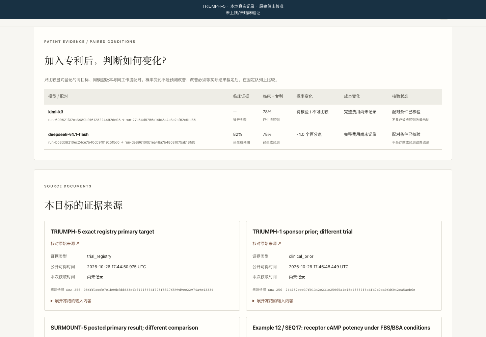

# 新目标的专利配对预测

本轮完成了 TRIUMPH-5 的新版本真实研究调用，以及可复用的离线双臂准备入口。它与此前 12 项资产赛季分开；不改旧截止时间、输入、失败记录或预测。

## 实际研究目标

- 试验：TRIUMPH-5，NCT06662383，Lilly 协议 J1I-MC-GZBP。
- 治疗比较：Retatrutide 与 Tirzepatide，随机、双盲、活性药对照。
- 主要终点：体重相对基线百分比变化，Baseline / Week 80。
- 人群：登记中的成年肥胖受试者；没有自行加入无糖尿病、BMI 数字阈值或已知分析集条件。
- 新 cohort：`of-retatrutide-pair-20261027-v1`。
- 共同截止：2026-10-26T17:46:48.518897+00:00。登记和结果核查在此之后、调用之前完成。

[官方登记](https://clinicaltrials.gov/study/NCT06662383)与[Lilly 试验页](https://trials.lilly.com/en-US/trial/549215)是目标依据。本次取得的登记 `hasResults=false`；对确切试验的有界中英文官方来源检索未找到决定性公告。这不能证明所有渠道均不存在披露。预计主要完成时间 2026-11、研究完成时间 2026-12 **不是结果发布日期**，官方读出时间保持未知。

统一成功事件是未来官方报告明确确认本试验的预设 Week80 主要优效分析达标。完整 SAP、estimand、实际分析集、剂量和多重性分配尚未取得；不填入假定 alpha。缺少主要分析资格证明、延期、非劣效性或其他 TRIUMPH 试验阳性，不解决这个二元事件；仍保留待定或混合状态。

## 真实执行结果

每个模型一次临床证据条件和一次加入专利条件，单次工作流、同一临床包与预算规则，无重试。以下数值只在内部研究记录中保留，**均未校准；公开 Success Probability 应为 N/A**。

| 模型 | 临床证据 | 临床＋专利 | 可以报告的变化 |
|---|---|---|---|
| kimi-k3 | 失败：`invalid_json`，无研究值 | 有效结构化输出，原始值 0.78 | 留空，失败的 control 不补造 |
| deepseek-v4.1-flash | 有效结构化输出，原始值 0.82 | 有效结构化输出，原始值 0.78 | 原始未校准值下降 0.04 |

3/4 表示结构化响应覆盖率，不是临床成功率。三个有效输出均偏向 Success；目标真实结果未解决，不排名、不标命中，Brier 与准确率均为空。一个药物项目的一次配对不能识别专利增益或模型优劣。

四次实际 attempt 共报告 input tokens 17,405、output tokens 11,747，其中报告 reasoning tokens 3,334 为子类，不再次相加；cache-read tokens 2,048 也不另加成输入。失败请求的已报告用量保留。货币价格及账单未知，费用不是零。模型标识由同一网关返回，不构成底层权重身份的独立认证。

注册时间凭证为 2026-10-26T17:51:10Z；首次开始 17:52:18Z，最后完成 17:55:25Z；预测凭证为 17:55:46Z。两份 FreeTSA RFC3161 签名均已验证，签名覆盖相应原始账本快照，不是法律公证或科学验证。原件保存在隔离研究运行目录，尚未通过生产站点发布。

[可复核的派生运行摘要](records/triumph5-patent-pair-20261027/run-summary.json)保留四个 run ID、状态、输入输出哈希、模型标识、原始值及时间凭证摘要。它不替代原始账本、冻结输入或签名清单。

## 输入与输出的科学限制

两组临床证据相同：TRIUMPH-5 登记、TRIUMPH-1 的已公布背景、SURMOUNT-5 的已登记主要结果。TRIUMPH-1 与 SURMOUNT-5 是不同试验，不得将其组均值相减当作 Retatrutide–Tirzepatide 的随机头对头效应。SURMOUNT-5 结局可评价人数 318/arm 不是其总随机人数；其 Tirzepatide 组是 15mg 或最大耐受剂量 10/15mg。

两个 sponsor 公告原始 HTTP 请求返回 403，失败记录保留。TRIUMPH-1 选定来源使用明确标记的 web-reader capture，没有冒充原始 HTTP 字节；其当前登记没有结果，但官方公告已有结果，说明 `hasResults=false` 不能单独证明未公布。

专利条件只追加 WO2019125938A1 Example12 / SEQ17 Table3 的完整工程化细胞 cAMP 卡，包括 EC50/SEM/n、剂量、培养条件、原文冲突和缺失项。旧 Example1 与其他实验未进入。来源核对为两个同基座 AI 角色，人工科学审核 0；体外活性不能推导人体效应或成功概率。

本次还对三个成功输出追加了 26 个选定声明—来源对的 AI 核查，保留逐字输出、冻结来源版本和原文锚点，未改预测值：

- Kimi 关于“预计800例即可保证功效”、跨试验标准误运输及目标差异 3–4% 的外推缺少依据。
- Flash 专利组“同剂量”的表述未获目标登记支持；目标剂量仍未知。
- 固定15mg表述省略了最大耐受剂量条件；不同 estimand、人群和随访时间不能混成一个临床效应。
- 真实数值、明确未知项与未经证实的假设分别记录。审核仅覆盖选定对，`claim_inventory_complete=false`，不可用这些不同分母的支持比例给模型排名。

这是 AI 诊断审核，与主审 AI 共用基座，错误可能相关；独立真人科学接纳和临床预测验证均未完成。

## 后续目标的准备命令

在 `apps/predome` 内运行：

```sh
python scripts/prepare_patent_pair.py \
  --clinical-spec /absolute/path/fresh-clinical-spec.json \
  --drug retatrutide \
  --patent-root /absolute/path/patent_data \
  --cohort-id NEW_UNIQUE_COHORT \
  --output-dir /absolute/path/new-proposal
```

输入须为已经完成当下结果核查的单目标 clinical-only spec，包含实际临床来源、共同 cutoff、未来 submission deadline、明确预算及模型。准备器不下载、不登记、不调用模型，也不创建 research-only 例外。

输出 `spec.json`、`budget.json`、`patent_packet.json` 和哈希 `manifest.json`。复用生产 evidence/target/packet/stage-plan 校验；仅追加当前 cutoff 合格的完整卡，不截断、不扩大预算。独占新目录防覆盖；在付费前拒绝缺失臂、不同临床包、不同版本、坏 review 和过期筛查。

实际执行继续使用现有 `arena_admin.py register`、独立注册时间凭证、`execute --max-calls` 和预测时间凭证流程。准备器输出不证明已经登记或完成请求；原始研究值始终与公开校准概率分开。

## 验证与部署状态

新准备器 45 项测试通过，相关真实临时账本集成联跑 118 项通过。本地完整 Python 回归 1,672 项通过。第一次浏览器启动因本机未解析 Playwright 包失败，配置已有运行时路径后，8 组实际前端 fixture 全部通过。

以下为实际四槽记录及三条 AI 来源评注的本地候选截图，加载现有正式页面组件，所有请求拦截；无关历史档案 bootstrap 置空。截图中的百分数是原始未校准研究值，不能放进公开校准概率栏。



[查看等待结果状态](images/triumph5-patent-pair-20261027/desktop-forecasts-pending.png)、[AI 来源评注](images/triumph5-patent-pair-20261027/desktop-ai-source-review.png)及[捕获依据](images/triumph5-patent-pair-20261027/provenance.json)。375px 移动端整页无横向溢出，六列表格自身须横向查看，分别保存[左侧](images/triumph5-patent-pair-20261027/mobile-patent-pair-left.png)和[右侧](images/triumph5-patent-pair-20261027/mobile-patent-pair-right.png)，不声称全部列在手机一屏内可读。

本轮运行使用独立本地账本，原有账本 DB/WAL 文件哈希未变。没有新增真实结果、真人审核或模型重试。生产仍为 1.2.7；当前 1.2.9 代码候选和新研究记录尚未部署，SSH 认证前连接重置仍是上线障碍。
