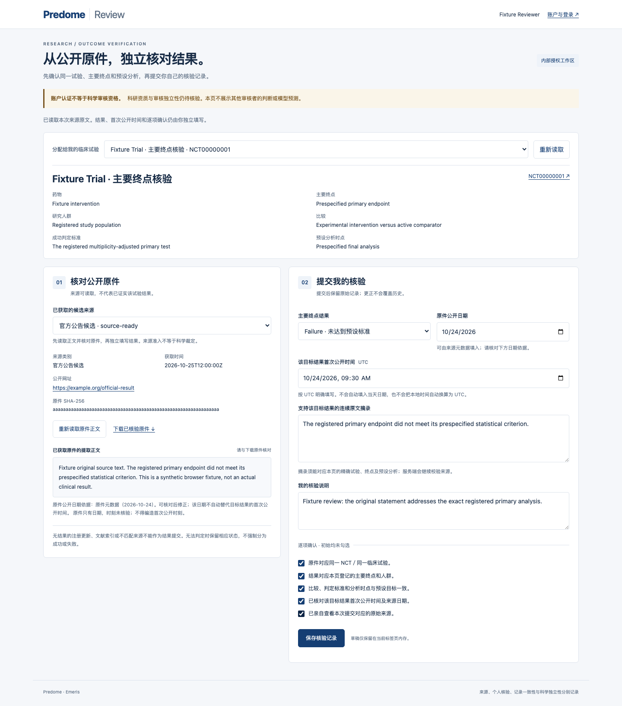

# 1.2.9候选：账号认证的结果来源核验

本版本把已获取的官方原件、确切预测目标和人工核验表连接到现有账号系统。它没有登记实际审核人、创建真实结果标签、调用模型或完成生产部署。科学审核人、其独立性和数据使用权利需要另外落实。

## 使用路径

内测端拟提供 `/arena/lab/review`，使用现有账号登录。服务端管理员先将现有稳定账号ID关联到一个持续不变的人员主体，并逐项分配已登记的预测目标。Jake的调试工作台权限不会自动变成结果核验权限；网页没有登记、授权或更换审核身份的功能。

```sh
python scripts/arena_reviewers.py --data-dir /absolute/existing/runtime list
python scripts/arena_reviewers.py --data-dir /absolute/existing/runtime enroll \
  --username EXACT_EXISTING_NAME --principal STABLE_PERSON_ID --target REGISTERED_TARGET_ID \
  --identity-evidence-file /absolute/private/identity-reference.pdf \
  --note "管理员核对的账号与主体关联依据"
```

上述占位符不是实际人员或可直接运行的配置。身份材料只在操作者本地计算哈希，不复制进Git或网页。更改授权必须通过`--supersedes`引用最新登记事件；`revoke`撤销未来提交权限，不删除或改写旧票。多个账号关联同一主体只计一个主体。账号登记记录OS操作者UID及声明依据，不认证临床资质，也不证明两人科学独立。

核验人依次选择确切目标、查看已保存的官方来源原件、摘录连续原文、填写主要终点结论及首次公开UTC时间，再分别确认试验、人群/终点对应、预设分析、首次公开与原件检查。页面不提供默认成功结论、不自动填首次公开时间、不展示模型预测或其他人的意见。只有日期时，时刻保持未核验；不得编造精确时间。公开日期、首次读出时间和获取时间分别保留。原件有带时区发布时间时，首次公开时间不能填在它之后。

`hasResults=false`、研究Completed状态、普通注册更新和文献索引不成为结果标签。已发布登记结果仍须核对具体主要分析；官方新闻候选仍可能只是指引，不能仅凭来源域名判断达标。来源完整性验证不替代科学判断。

## 身份、版本与记录

API从真实登录会话取得稳定账号ID，拒绝请求体中的账号、人员ID或审核类型。每次提交固定目标哈希、来源原字节哈希、最新授权事件、自己的上一票和上一轮裁定版本。来源解析后重新检查会话，授权在账本写锁内再次核对。原件解析子进程不继承服务凭据。账号已有不可覆盖的认证审核时，自动删除被拒绝并要求处理记录保留事宜。

同一事实的个人备注存放于各自审核记录，不改变共同结果哈希。认证票与旧的操作者自报身份票分开形成一致性。两位不同主体的一致票可形成工程上的一致记录；`scientific_credentials_verified`和`independent_human_review_verified`仍为false，不能据此声称独立科学验证已完成。

每次结果裁定结束一轮，后续更正须重新获得该轮次的票。同一结果哈希在历史上再次出现，也不会复用更早轮次的票。原始事件、旧预测和失败记录保留。

公开页面继续只接收允许的临床字段，不包含账号、主体ID、个人备注或原文核验摘录。443端口封闭核验页面及接口；18443仅给`/api/arena/review/`开放经过独立角色检查的GET/HEAD/POST，其他调试接口保持只读。应用仅对该结果提交路由接受配置主机的18443 Origin，其他修改接口不获得这项例外。

## 验证与发布

从应用目录运行`python scripts/check.py --suite full --browser`；干净源码副本使用默认source套件。新增API、真实临时Ledger、真实CLI子进程及生产页面浏览器fixture分别覆盖身份注入、授权范围、来源损坏、时间上界、注销/撤权、重复提交、更正轮次、XSS和桌面/窄屏布局。所有fixture是合成工程材料，不能作为实际专家审查或临床结果。

1.2.8九文件传输包仍固定旧提交，不适用于本版新增导入和端口配置。1.2.9使用独立部署器及完整文件白名单：固定1.2.7基线、原始Nginx哈希、数据库备份、源码导入预检、保留既有公开凭证下载路由的定点配置升级、配置预检、原子切换、健康与旧记录核验。失败时仅回退代码与本站点配置，不恢复或覆盖数据库。部署完成必须以远端收据、HTTPS健康及实际权限检查为准；本地准备和测试不算上线。

上一轮GitHub CI的源码检查通过，后续在Ubuntu apt HTTP镜像等待至20分钟超时，macOS ARM runner未获分配。本版固定Ubuntu 24.04与macOS 15 Intel，给包管理器设置超时并使用官方HTTPS镜像；继续执行全部浏览器检查，不将安装失败变成跳过或成功。配置依据见[GitHub runner文档](https://docs.github.com/en/actions/reference/runners/github-hosted-runners)与[Playwright系统依赖说明](https://playwright.dev/docs/browsers#install-system-dependencies)。实际CI结果另以提交对应运行记录为准。

## 实际页面截图（隔离测试）

以下截图由提交`35e0362`的生产页面资产渲染，API完全拦截，使用合成试验与虚构核验账号；表单内容由浏览器测试填写，不是页面默认结论，也不是真实审核记录或线上部署截图。



[查看375px移动端截图](images/review-1.2.9/fixture-mobile.png)。
