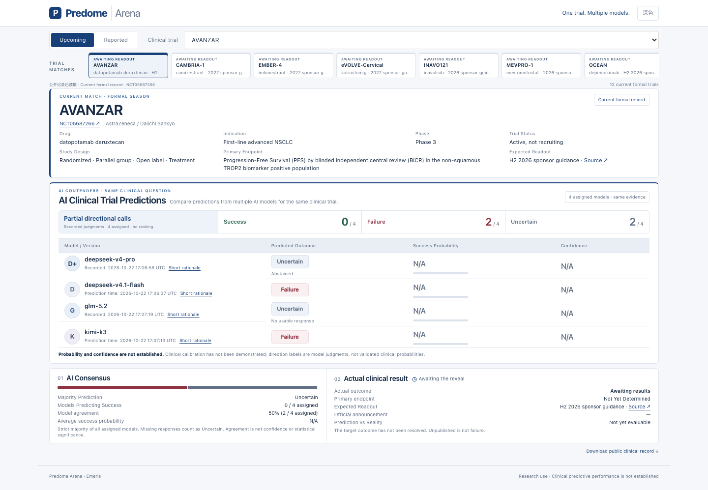
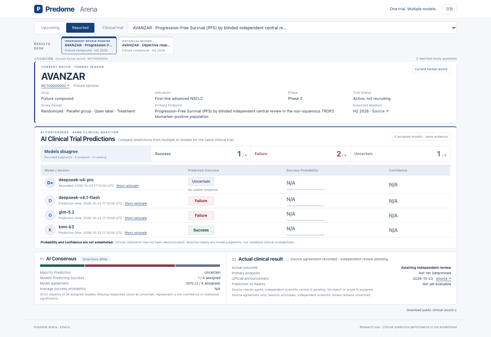

# 逐结果科学接纳与计分资格

来源核对的一致性、人工科学接纳和预测能力验证分别记录。两条AI意见、两个自报人工身份或两个已登录账号达成一致，可以保留为原有`result_adjudicated`来源记录，但不会自动获得公开命中标记、共同任务Brier、专利评分增益或离线结果误差标签。

新的接纳政策只由受托操作者在服务器命令行执行。它记录责任人对两份具体科学审核的材料核查与接纳，不自动认证执照、文件真实性、利益独立性或临床预测有效性。实际审核人的身份、授权、任务适配的科学资格和独立性材料必须由团队落实；Jake的调试权限不提供这些事实。本轮全部正向验收使用隔离的合成材料，没有新增真实科学接纳。

## 可操作路径

1. 两位已明确授权的真实人员使用各自现有账号，独立检查同一试验、人群、终点、对照、分析时点和来源首次公开时间。每份来源审核由现有核验工作区保存；审核者不看模型预测或另一人的判断。
2. 受托操作者为当前一致结果生成待填写的材料清单。模板的空字段不能视为核查完成。

```sh
python scripts/arena_scientific_acceptance.py --data-dir /absolute/existing/runtime prepare \
  --target EXACT_REGISTERED_TARGET --output /absolute/private/acceptance.json
```

3. 责任人核对每位审核者适合本任务的科学角色，填写资格核查方法、核查说明、原始资格材料路径、针对该目标／项目的独立性与利益冲突核查说明和原始声明路径，并逐项确认。还须提供与两份来源审核哈希一致的原始临床来源文件。填写接纳责任人和具体说明。相对文件路径以清单所在目录为基准；私有材料不上传Git或公开网页。
4. 检查完成后才执行接纳。未知字段、占位空值、错试验、错结果轮次、非认证票或同一主体的两个账号会被拒绝。

```sh
python scripts/arena_scientific_acceptance.py --data-dir /absolute/existing/runtime accept \
  --document /absolute/private/acceptance.json
python scripts/arena_scientific_acceptance.py --data-dir /absolute/existing/runtime list \
  --target EXACT_REGISTERED_TARGET
```

以上路径和标识均为占位符，不构成真实人员授权。接纳在追加账本事件前核对当前结果事件哈希、问题绑定、结果哈希及两份账号审核；不是仅检查两个姓名字符串或一个结果标签。原始临床来源、资格资料和独立性声明复制到运行目录的私有内容寻址档案并读回校验，文件权限为0600，目录0700，归属运行账本的服务账号。清单与原件由受托操作者保管。

## 撤销、更正与原件完整性

```sh
python scripts/arena_scientific_acceptance.py --data-dir /absolute/existing/runtime revoke \
  --target EXACT_REGISTERED_TARGET --supersedes LATEST_ACCEPTANCE_EVENT_SHA256 \
  --acceptor "真实责任人" --note "实际撤销依据与后续处理"
```

撤销只追加事件，不删除历史。重新接纳须显式引用最新接纳或撤销事件。新一轮结果更正必须重新获得个别审核和接纳，即使结论A→B→A、结果哈希回到旧值，也不会继承早先的接纳。每次从账本生成投影时重新核对私有原件；原件丢失、权限异常或哈希变化使资格失效，并保留历史与内部错误原因。来源归档与账本需要一并备份；代码回滚不得恢复数据库覆盖并发新记录。

## 页面与分析的共同规则

| 状态 | 公开呈现 | 正式命中／二元评分 |
|---|---|---|
| 尚无来源一致记录 | 待揭晓或已公布待来源核对 | 无 |
| 来源一致，未科学接纳 | `agreement_pending_independent_review`；保留来源／时间，结果标签待核验 | 无 |
| 当前结果已按政策接纳 | `review_status=accepted`；展示对应实际结果 | 还须满足原有模型版本、有效输出、证据与事前时间规则 |
| 已接纳Mixed／Inconclusive | 保留混合或不确定结论 | 不强制转换为二元结局 |
| 历史回放 | 保留历史标签、来源及历史标识 | 不计前瞻成绩 |
| 接纳被撤销、过期于新结果轮次或原件损坏 | 回到待独立科学审核 | 无 |

运行时、公开投影、共同任务指标、专利配对和离线误差分析共用同一资格策略。公开的`scoring_eligible`只表达该条二元结果具备进入计分检查的资格，不表示模型已经通过时间／输入等其他条件，也不表示经校准的临床成功概率。公开页不输出人员ID、资格内容、接纳责任人、私有路径或原件摘要。缺少资格的新旧记录均按未接纳处理；JSON中自行添加`verified=true`不能签发资格。

账号审核原有`scientific_credentials_verified`与`independent_human_review_verified`仍保持false。新增接纳对象记录的是人工材料核查的信任依据，不能把工程通过或团队接纳外推成独立临床验证、准确率提升、药物有效性或训练完成。

## 页面验收

以下AVANZAR截图使用2026-10-26 16:01 UTC只读取得的线上公开记录，在本地候选前端渲染；不是1.2.9已部署截图。当前真实记录为两条Failure方向判断、一条运行失败和一条拒答，实际临床结果仍待揭晓。概率／置信度保持N/A，运行失败没有转换为疗效失败。



[375px移动端截图](images/scientific-result-acceptance/avanzar-public-snapshot-mobile.png) · [未修改的公开目标响应](images/scientific-result-acceptance/public-target-snapshot.json) · [来源、时间与哈希](images/scientific-result-acceptance/snapshot-provenance.json)。移动端采用纵向卡片，需要滚动。

下面单独展示“来源一致但尚未科学接纳”的合成分支。真实快照的结果为pending，没有把合成试验或合成审核当作真实裁定。


