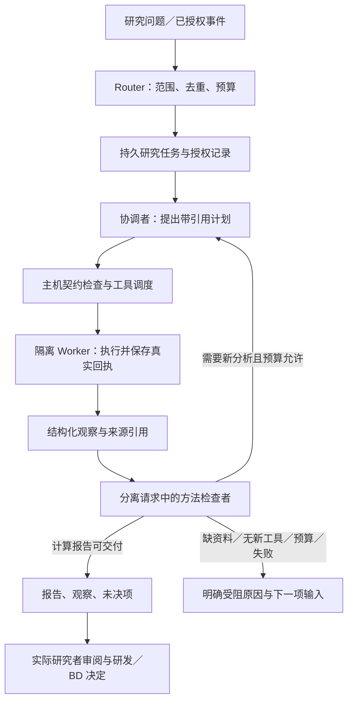

# 从可追溯工作台到可持续运行的 Virtual Biotech

关联 [Issue #69](https://github.com/james-lebron2000/EmerisBiotech/issues/69)、#29、#30、#32、#34。目标是在一次明确的研究授权下，持续完成计算研究：提出计划、实际执行、读取观察、检查方法、追加分析，最终交付有来源的报告或具体缺口。

## 核对的一手资料

1. [Virtual Biotech 作者仓库](https://github.com/harrisongzhang/TheVirtualBiotech) 及已封存作者源码 `71f9da6`：CSO 接收问题，专业代理提供分析，scientific reviewer 检查方法与问题对齐，CSO 安排补充分析并综合结果。作者明确将它定位为 human-guided research。正式发表条目见 [PubMed](https://pubmed.ncbi.nlm.nih.gov/42752167/)；本次 Science 全文入口返回 403，未以摘要替代全文核对。既有 UC 科学复现仍受封存 bioRxiv v1 的范围限制。
2. [DeepSeek 官方原型](https://github.com/deepseek-ai/dsh-superagent-prototype/tree/6337fc823ce20251c8de8085948165c81aaa701e)：本次固定提交为 `6337fc823ce20251c8de8085948165c81aaa701e`，阅读 README 及 Philosophy、Domain、Authorization、Execution、Architecture 六个文件，文件哈希存于本地调研清单。原型说明其不是正式产品，且与架构文章／内部版本不完全相同；不把未实现的探索当成已经验证的能力。
3. 关键设计依据：[领域模型](https://github.com/deepseek-ai/dsh-superagent-prototype/blob/6337fc823ce20251c8de8085948165c81aaa701e/docs/001-domain.md)、[执行与恢复](https://github.com/deepseek-ai/dsh-superagent-prototype/blob/6337fc823ce20251c8de8085948165c81aaa701e/docs/003-execution.md)、[架构](https://github.com/deepseek-ai/dsh-superagent-prototype/blob/6337fc823ce20251c8de8085948165c81aaa701e/docs/007-architecture.md)。借鉴任务的持久授权和结构化生命周期，不复制原型的代码执行权限。该原型也说明 wrapper 不是安全边界；本项目继续使用固定只读 worker，并为未来生信执行保留真实沙箱要求。

这里只学习公开实现并作本项目设计，没有安装或运行 DeepSeek 原型，也未下载研究数据。

## 核心判断

原来的工作台已有证据与运行记录，但用户仍承担循环控制：生成一次草案、逐步运行，再把结果交回模型。模型看不到自己的工具观察，就无法形成后续研究。增加代理名字或提示词不能补上这个断点。

两层职责分别落位：Router 管触发、归属、授权与派发；CSO 属于科研工作单元，负责科学路线、证据综合与补充分析。持续在线和并行调度属于运行系统，专业知识属于工作单元。本轮实现单项目的有界持久任务，不将它称为完整 DeepSeek 框架移植或论文全场景复现。



## 本轮实现与边界

| 公开原型中的概念 | 在本项目中的实现 | 仍未实现 |
| --- | --- | --- |
| Trigger／Mandate | 触发编号、冻结研究范围、允许工具、交付条件、模型目标和次数／时间预算；同编号幂等，变化要求新授权 | 通用来源连接器、认证主体和规则驱动准入 |
| Ticket／Assignment | 追加事件中的研究任务；本地内核锁保证同项目控制器不重复；模型和工具请求归属任务 | 跨主机移交、多个项目的全局预算与 worker 并发 |
| Worker Session | 协调与方法检查使用分离的模型请求；固定工具使用隔离子进程，实际观察返回下一轮 | 持久多模型专业代理会话、专业工具全覆盖 |
| Durable context | 研究来源包与过程观察分开：任务模型输入含真实回执、前轮结构化决定和剩余预算；保存完整请求快照及哈希 | 通用长文溢出／链式召回，本轮不声称实现文章全部记忆设计 |
| Recovery／Reports | 模型无回执保持未知且不自动重发；工具核查使用原执行锁，不把父进程消失当作子进程已停；重复运行不重复交付 | 持续后台服务和生产自动恢复的长期验收 |

来源包只在来源／研究内容变化时改变。任务模型另外读取带观察的决策包，避免“新增自己的回执使当前工具批次立刻失效”。模型计划仍须通过现有草案契约；工具输出不能授权新工具，模型也不能扩大 Mandate。

模型角色是软件角色，同提供方的两次请求不等于独立人工科学审阅。报告状态 `delivered_unreviewed` 只说明计算报告已交付；不会自动新增科学审阅、实验、实验结果或研发／BD 决定。

## 两种实际模式

### 既有证据核对

主机固定流程运行来源哈希核对和已有交互结果提取，输出真实工具回执、全部所报数值和缺失项。它可以在无模型配置时连续运行，但不是自由规划的模型研究，也不重新拟合模型或复原作者 agent session。

### 模型研究

一次授权当前模型目标与数据范围后，协调请求生成计划，工具实际运行，方法检查请求读取观察，决定补充分析、交付报告或指出缺失输入。输出契约校验失败即停止，不自动修复或重试。只有完成本任务要求的工具观察并经过方法检查角色，才允许交付计算报告。

每任务最多 8 次模型请求、16 次工具尝试和 600 秒执行窗口。执行窗口从首次运行开始；每次工具预留不超过任务剩余时间。模型有现有响应／输出上限；提供方 token 和估算成本单独记录，金额预算尚未实现，也不能把未知费用填零。超时／取消保留在途事实；主机 DNS 或文件读取不构成严格操作系统墙钟保证。

成功工具对同一冻结来源不重复运行；只有手工研究任务或没有新的已授权动作时，返回具体缺口。来源范围或模型目标变化停止当前授权，不默默改用另一个模型。模型请求中断后不能因控制器重启而自动再收费请求。

## 操作

页面 `/programs?id=<program>#research-missions` 提供任务授权、运行／续跑、停止和导出。授权声明仍是本地记录，真实账号认证由 Issue #32 继续建设。模型未配置时只开放固定核对模式。

CLI 示例，状态目录需为本机磁盘：

```sh
uv run python scripts/research_missions.py --state-dir "$VBT_UC_STATE" \
  --program osmr-uc-independent create --mode existing_evidence \
  --trigger-id uc-verification-001 \
  --goal '核对 UC 已绑定来源与所报交互结果，形成带引用的核对报告' \
  --criteria '保留全部所报效应、区间与缺失项，不推断 OSMR 阻断疗效' \
  --max-model-calls 0 --max-tool-attempts 4 --max-seconds 120 \
  --author '实际操作记录人'

uv run python scripts/research_missions.py --state-dir "$VBT_UC_STATE" \
  --program osmr-uc-independent run --mission "$VBT_MISSION_ID" \
  --author '实际操作记录人'
```

模型模式使用 `model_research`、2–8 次调用、`--allow-model-send` 及当前主机非秘密配置指纹 `--config-hash`。不在命令行或网页录入密钥。`run` 只有报告交付返回 0，明确受阻／预算／未知／停止返回 2；导出包含任务、观察、请求回执和报告。恢复只读副本拒绝运行。

## 下一步必须补上的能力

1. **真实提供方验收**：在用户授权的主机配置上运行 UC，验证反馈真的被下一轮使用；受控 transport fixture 不能代替这一项。
2. **可信分析工具**（[Issue #70](https://github.com/james-lebron2000/EmerisBiotech/issues/70)）：将样本／终点校验、差异与交互模型、遗传、单细胞、安全与临床工具接入 typed artifacts 和沙箱。每项有输入版本、独立单位、方法、输出契约和失败条件。仅两种摘要工具不足以复现整篇论文。
3. **专业工作单元与并发**：CSO 内部按科学问题委派专业 worker，方法检查读取可核查产物；Router 保持轻量。跨项目共享资料与全局预算需独立建模。
4. **事件驱动与持续运行**：先接入项目内来源／工具／审阅事件，再接允许的外部来源，保存游标与订阅，确定哪些变化值得触发新授权任务。外部内容不能自行授予权限。
5. **独立比较**：冻结问题、来源、截止时点、工具与预算，对比人工串联、单次模型和持续研究模式；评价可复算率、引用正确率、科学错误、人工介入、耗时与成本。工程跑通不能证明超过原论文或改善药物开发。

## 本轮验证记录

本地全量 1855 passed / 1 skipped（未分发原始公司披露材料），七文件定向 175 passed。实际 UC 固定核对模式自动运行 2 次工具，核对 3 个绑定摘要，提取 4 行已有交互结果，交付 5 项带回执引用的记录与未决项；重复运行未新增事件，原项目状态未变。

真实模型请求仍为 0。多轮计划→工具观察→方法检查→交付、取消、无进展、预算、未知请求和回执恢复由合成模型／工程 fixture 验证，不能称为真实提供方或科研价值验证。尚未重新拟合交互模型，也未运行完整原作者 UC agent session。
